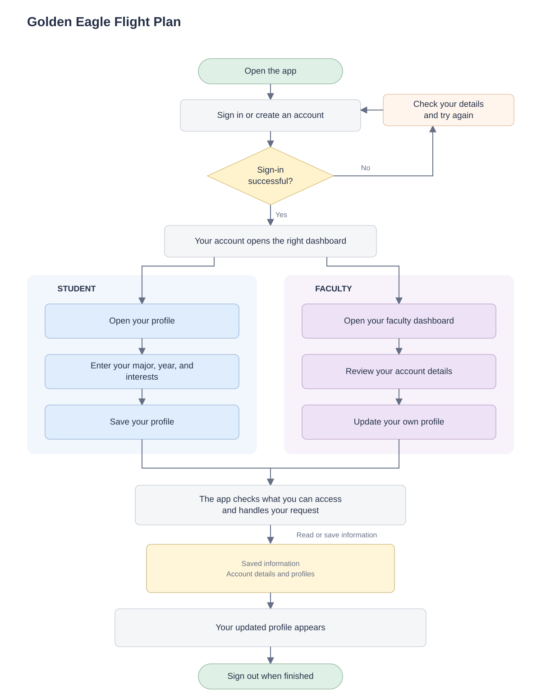

# Golden Eagle Flight Plan

This is our CS3338 final project, based on the
[AI-Powered University Information System](https://ascent.cysun.org/project/project/view/253).

Golden Eagle Flight Plan is designed to help students find campus events and resources and keep track of their academic preparation, career development, and community involvement. Faculty and student organizations will be able to share events, while students can find opportunities that match their interests.

## Snapshot 1

We are starting with the requirements, account design, and development environment. The goals for this snapshot are to:

- Define the student, faculty, student organization, and administrator roles.
- Design registration, login, logout, and account approval.
- Plan the user, role, and profile tables and the permissions between them.
- Set up the frontend, backend, and database for development.

The repository currently contains a React frontend, an Express backend, and a PostgreSQL database starter. The starter records page visits and displays the total in the browser. Registration, login, and the Flight Plan features are being planned in the SRS and SDD; they are not part of the current starter application.

Jira has not been set up yet.

## Pre-requisites

Building the documentation requires `make` and `pdflatex`. On macOS, the repository's setup script installs Homebrew, MacTeX, and the additional LaTeX packages:

```sh
./setup.sh
```

Running the application starter requires Docker with Docker Compose.

## Building the documentation

From the repository root, run:

```sh
make
```

The documents are written in LaTeX as `.tex` files inside `docs`. The Makefiles compile them into PDFs and run LaTeX twice to update the table of contents.

To build only the user manual or workflow document:

```sh
make -C docs/User_Manual
make -C docs/Workflow_Diagram
```

## Running the starter application

Download or clone this repository:

```sh
git clone https://github.com/jasonreese9/CS3338Final.git
cd CS3338Final
```

Create a local `.env` file inside `src` with `STUDENT_NAME`, `POSTGRES_USER`, `POSTGRES_PASSWORD`, and `POSTGRES_DB`. Choose local database credentials and use the same values for the database and backend through the existing Compose configuration. Keep this file out of GitHub.

From the repository root:

```sh
cd src
docker compose up --build
```

Open http://localhost:3000. The page displays a greeting from the backend and a visit count stored in PostgreSQL. Refresh the page to request another count. The backend is available at http://localhost:5001.

To stop the services, press `Ctrl+C`, then run `docker compose down` from `src`. The database uses the `db-data` volume to retain its data between runs.

If the page says it cannot reach the backend, check that all three services are running with `docker compose ps`. Use `docker compose logs backend db` to check the database connection and backend startup.

## Workflow

The Snapshot 1 diagram shows the planned account and profile workflow. The current starter uses a simpler path: the browser calls the backend, the backend records a visit in PostgreSQL, and the browser displays the response.



The [workflow document](docs/Workflow_Diagram/Workflow_Diagram.pdf) explains both paths. The diagram's editable source is [workflow.mmd](docs/Workflow_Diagram/workflow.mmd).

## Layout

```text
.
├── assets
│   ├── SDD_images
│   └── SRS_images
├── docs
│   ├── Snapshot_Objectives
│   ├── Software_Design_Document
│   ├── Software_Requirement_Specification
│   ├── TestRail_Document
│   ├── User_Manual
│   ├── Workflow_Diagram
│   ├── diagrams
│   └── project_design_spec.tex
├── reference
└── src
    ├── backend
    ├── frontend
    └── docker-compose.yml
```

- **assets:** Images used in the documents.
- **docs/Snapshot_Objectives:** Goals and reflections for each snapshot.
- **docs/Software_Design_Document:** System architecture, database design, and screen design.
- **docs/Software_Requirement_Specification:** User roles, features, interfaces, and legal and ethical requirements.
- **docs/TestRail_Document:** Test documentation and reports as testing progresses.
- **docs/User_Manual:** The LaTeX user manual and its compiled PDF.
- **docs/Workflow_Diagram:** The workflow diagram, editable source, and LaTeX document.
- **docs/diagrams:** Supporting diagrams for the design specification.
- **docs/project_design_spec.tex:** Page, component, dependency, and container design details.
- **reference:** Files from the original senior design project.
- **src/backend:** The Express application and backend Dockerfile.
- **src/frontend:** The React application and frontend Dockerfile.

We will update this README and the user manual at each snapshot as features are added and the setup changes.
